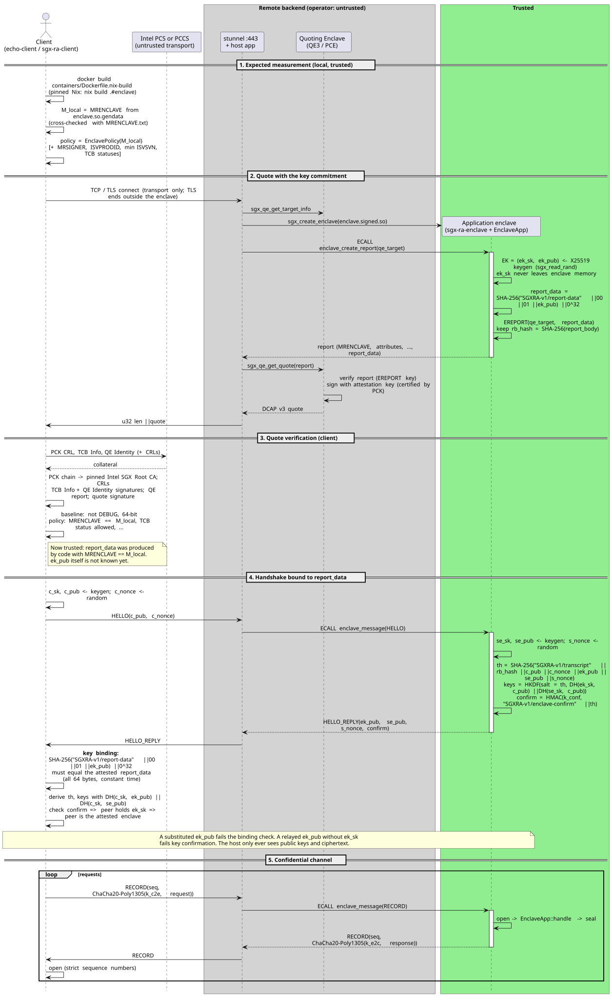

# sgx-ra: reproducible Rust SGX enclaves with attested channels

A Rust framework for Intel SGX enclaves that run on the remote executor of
[sgx-playground](https://github.com/blechschmidt/sgx-playground). Clients
rebuild an enclave bit for bit, check a DCAP quote against that
measurement, and talk to the enclave over a channel whose key exists only
inside it.

* `crates/`: the framework. `sgx-ra-core` (protocol and the reusable
  `Attester` / `Verifier` / `Policy` / `SecureChannel` interfaces, no_std),
  `sgx-ra-enclave` (enclave runtime, `EnclaveApp`), `sgx-ra-host`
  (untrusted host), `sgx-ra-verifier` (DCAP), `sgx-ra-client`.
* `examples/`: the echo enclave, host and client, and the sealing
  enclave and client, all built on the framework.
* `enclave-sys/`: EDL, enclave config and the link/sign script
  ([README](enclave-sys/README.md)).
* `extra/sequence.wsd`: the sequence diagram below (PlantUML).

## Try it

With Rust and a container engine (Docker or Podman) installed:

```sh
cargo run --release -p echo-client
```

The client rebuilds the echo enclave bit for bit in the Nix container,
attests the enclave behind `sgx-playground.blechschmidt.io:443` against
that MRENCLAVE and exchanges a message over the attested channel. The
public executor runs the Rust host and echo enclave on real SGX hardware.
It is a KVM guest whose platform TCB status is
`OutOfDateConfigurationNeeded`. By default the client accepts a
non-`UpToDate` platform only through two explicit allowlists: TCB statuses
(those of current Ice Lake SP servers) and Intel advisory IDs
(INTEL-SA-00615, -00657, -00767, -01079, -01103, -01153). Any other
advisory is rejected. It warns with the advisories and lists the TCB
components that fall short and who can fix them.
That status is set by the physical host's BIOS and microcode, which the VM
can't change ([TCB_STATUS.md](docs/TCB_STATUS.md)).
Pass `--strict-tcb` to accept only `UpToDate` platforms.
See [QUICKSTART.md](docs/QUICKSTART.md) for details.

### Live output

Output of the command above against `sgx-playground.blechschmidt.io:443`
on 2026-11-26, from a host with the classic Docker builder. Only the
Docker/Nix build log is cut and the temporary directory shortened; the
attestation lines are verbatim. The Nix build came from the Docker layer
cache here; a cold build takes several minutes. The MRENCLAVE matches the
[measurements table](#measurements-of-the-echo-enclave) below.

```text
$ cargo run --release -p echo-client
     Building the enclave from source with docker (containers/Dockerfile.nix-build, context .); this can take several minutes
INFO  sgx_ra_client::build: running "docker" "build" "-f" "containers/Dockerfile.nix-build" "-t" "sgx-ra-client-build:latest" "."
[... Nix build output elided ...]
[OK] Reproducible build finished; enclave measured by sgx_sign (/tmp/echo-client-build-…/out/enclave.so.gendata)
[OK] Expected MRENCLAVE from the local build: 3f31f2322a4e22e136b60bc620b0de75e2c50737699f8d8b9e3af11da67aa3af
     Build signing key MRSIGNER: 8b1beba60b7c004561b8eb5e8384ff03f988e3914e5c845ee3362b786b34efa6 (pin with --mrsigner if wanted)
[OK] Connected to sgx-playground.blechschmidt.io:443 via TLS (TLSv1_3, TLS13_AES_256_GCM_SHA384, certificate verified against the Mozilla roots); TLS ends outside the enclave and is treated as an untrusted pipe
INFO  echo_client::run: waiting for the quote announcement (up to 120 s)
[OK] Received quote (4734 bytes)
[OK] Quote structure valid: DCAP v3 ECDSA-P256 quote from the Intel QE, PCK certificate chain attached
INFO  echo_client::run: fetching collateral from https://api.trustedservices.intel.com
[OK] PCK certificate chain verified up to the pinned Intel SGX Root CA (SHA-256 44a0196b2b99f889b8e149e95b807a350e7424964399e885a7cbb8ccfab674d3); Intel SGX PCK Platform CA and Root CA CRLs checked, PCK certificate not revoked
[OK] TCB Info (FMSPC 00606a000000) and QE Identity signed by Intel SGX TCB Signing; collateral valid until 2026-12-26T17:40:29Z (TCB evaluation data number 20)
[OK] Quoting enclave report signed by the PCK key and matches QE Identity (QE TCB status UpToDate); attestation key bound to it
[OK] Quote signature over header and enclave report verified with the attestation key
[OK] Platform TCB status OutOfDateConfigurationNeeded (platform OutOfDateConfigurationNeeded, TCB date 2024-03-13T00:00:00Z); allowed by policy
     Intel security advisories: INTEL-SA-00657, INTEL-SA-00767, INTEL-SA-01079, INTEL-SA-01103, INTEL-SA-01153, INTEL-SA-00615 (all on the advisory allowlist)
     The best TCB level Intel defines for this platform type is SWHardeningNeeded (TCB date 2025-08-13T00:00:00Z); this platform falls short of it:
       component 0 (BIOS, Early Microcode Update) is 14 < 15: update the BIOS / microcode of the physical host
       component 1 (OS/VMM, SGX Late Microcode Update) is 14 < 16: load newer microcode in the host OS / VMM, or update the BIOS
       component 6 is 0 < 1: update or reconfigure the BIOS of the physical host
     Only the operator of the physical machine can raise these SVNs (docs/TCB_STATUS.md); nothing in the enclave, the host app or the client changes them
[OK] Enclave is not in debug mode (DEBUG attribute clear) and is 64-bit
[OK] Remote MRENCLAVE 3f31f2322a4e22e136b60bc620b0de75e2c50737699f8d8b9e3af11da67aa3af is identical to the local build: the remote runs exactly the code we built
     MRSIGNER 8b1beba60b7c004561b8eb5e8384ff03f988e3914e5c845ee3362b786b34efa6 (not pinned)
[OK] ISVPRODID 1 = 1 (from the build's SIGSTRUCT)
[OK] ISVSVN 1 >= 1 (from the build's SIGSTRUCT)
WARN  echo_client::run: accepted a platform with TCB status OutOfDateConfigurationNeeded (affected by INTEL-SA-00657, INTEL-SA-00767, INTEL-SA-01079, INTEL-SA-01103, INTEL-SA-01153, INTEL-SA-00615); pass --strict-tcb to require UpToDate
[OK] Attested report_data binds the enclave's channel public key c4fc271ec431bdb436cff64640a6886a1fdddeff3316957a62e74f474cf4d67d: report_data = SHA-256("SGXRA-v1/report-data" || 00 01 || key) || 0^32 = a61ffae2ab289b6630aeaefafc82692116d188d19a48dc3de8c6534a9697a2e3…
[OK] Handshake complete: the enclave proved possession of the attested private key (key confirmation verified); the key exists only inside the enclave with the verified MRENCLAVE
[OK] Confidential channel established (X25519 + HKDF-SHA256, ChaCha20-Poly1305 records)
[OK] Sent 18 bytes encrypted; reply of 18 bytes decrypted and authenticated
Reply received from server: Hello, SGX server!
[OK] Echo matches the request
```

> **Verifying needs no SGX.** The client, quote verifier and channel are
> pure Rust with the Intel SGX Root CA compiled in, and they fetch
> collateral from Intel's PCS by default. Any Linux/macOS host with Docker
> (for the reproducible build) and Internet access can attest the enclave.
> `scripts/verify-without-sgx.sh` proves this in a container without SGX
> devices, AESM, SGX libraries or a PCCS
> ([QUICKSTART.md](docs/QUICKSTART.md#verifying-from-a-host-without-sgx)).

> **No Intel API key anywhere.** Verifiers fetch collateral and SGX hosts
> fetch their PCK certificate from Intel's PCS v4, which serves both without
> a subscription key. Only the blueprint's optional PCCS cache still wants
> one. [NO_API_KEY.md](docs/NO_API_KEY.md) has the endpoint-by-endpoint findings.

## Documentation

| Document | Read it to |
|---|---|
| [QUICKSTART.md](docs/QUICKSTART.md) | run the reproducible Nix build and the Rust client against `sgx-playground.blechschmidt.io`, from any host (no SGX needed) |
| [NO_API_KEY.md](docs/NO_API_KEY.md) | see which Intel endpoints need an API key (only the PCCS's) and how quoting and verifying avoid it |
| [NEW_ENCLAVE_APP.md](docs/NEW_ENCLAVE_APP.md) | write your own enclave on the framework: implement `EnclaveApp`, define a `Policy`, reuse the host, `Attester` / `Verifier` / `SecureChannel` |
| [REPRODUCIBILITY.md](docs/REPRODUCIBILITY.md) | reproduce MRENCLAVE bit for bit on another host, and debug a mismatch |
| [PROTOCOL.md](docs/PROTOCOL.md) | the wire protocol spec: the executor framing, quote layout, key binding (§6.2), handshake (§6.4), records |
| [TCB_STATUS.md](docs/TCB_STATUS.md) | find out why the executor is `OutOfDateConfigurationNeeded`, which SVNs fall short and who can fix them |
| [THREAT_MODEL.md](docs/THREAT_MODEL.md) | the trust assumptions, the security review and the open issues |
| [ARCHITECTURE.md](docs/ARCHITECTURE.md) | the crate layout, trait boundaries, reproducible build design |
| [SEALING.md](docs/SEALING.md) | sealing, storage OCALLs and the optional long-term enclave identity |

## How the key binding works



The enclave generates its channel key `EK` inside the enclave and writes
`SHA-256(label ‖ ek_pub)` into the report_data of its quote. The client
trusts that value only after the quote has been verified up to Intel's
root and MRENCLAVE matches the client's own reproducible build. In the
handshake, the client checks that the `ek_pub` it receives hashes to
exactly that report_data. It also checks a key confirmation that only the
holder of `ek_sk` can compute. The channel key therefore exists only
inside an enclave running the code the client built. The untrusted host,
the operator and the TLS terminator see only public keys and ciphertext.
Details are in [PROTOCOL.md §6](docs/PROTOCOL.md#6-attested-channel-protocol-layer-2-framework-sgxra-v1).

## Blueprint TODOs

The [blueprint](https://github.com/blechschmidt/sgx-playground) README
lists six TODOs. All of them are implemented here:

- [x] **Rust implementation**: the enclave, host and client are Rust
  (`crates/`, `examples/`). The enclave is `no_std` on Intel's trusted
  runtime and keeps the blueprint's EDL, so the operator's existing host
  can load it.
- [x] **Sealing PoC**: `examples/sealing-enclave` and `sealing-client`
  seal client data to MRENCLAVE and keep a sealed long-term identity key
  ([SEALING.md](docs/SEALING.md)).
- [x] **Secure channel into the enclave, with report_data pinning a hash
  of the public key**: SGXRA v1. It uses X25519, HKDF-SHA256 and
  ChaCha20-Poly1305, with key confirmation
  ([PROTOCOL.md §6](docs/PROTOCOL.md#6-attested-channel-protocol-layer-2-framework-sgxra-v1)).
- [x] **Improved reproducibility with Nix**: `flake.nix` with a
  digest-pinned build container. All artifacts, including
  `enclave.signed.so`, are bit-for-bit reproducible
  ([REPRODUCIBILITY.md](docs/REPRODUCIBILITY.md)).
- [x] **MRSIGNER verification**: `EnclavePolicy::with_mr_signer` /
  `echo-client --mrsigner`, alongside ISVPRODID and ISVSVN checks. Our
  builds are signed with a published key, so MRENCLAVE remains the pin
  that carries trust. MRSIGNER is useful when you re-sign with a private
  key.
- [x] **Server app containerization**: `nix build .#host-app-image` builds
  a reproducible OCI image of the Rust host, the enclave and Intel's
  runtime. Use it with `compose.yaml` (`host-app`) and
  `containers/wrapper.sh` for stunnel.

## Reproducible enclave build

`flake.nix` pins everything that reaches the enclave:

| Input | Pinned by |
|-------|-----------|
| nixpkgs `nixos-26.05` @ `94c3211b`, crane v0.24.0, fenix | revision + narHash (`flake.lock`) |
| Rust 1.100.0 (`rust-toolchain.toml`, incl. `x86_64-unknown-none`) | sha256 of the rustup channel manifest |
| Intel SGX SDK 2.26.100.0 (Intel's prebuilt release) | sha256 (fixed-output derivation, `nix/sgx-sdk.nix`) |
| Intel SGX DCAP 1.23 (source + headers, for the host) | commit + hash (`nix/dcap.nix`) |
| crates | `Cargo.lock` checksums (crane vendoring, `--offline --locked`) |
| build container | `nixos/nix:2.36.0@sha256:74628055…` |

Build in the container (needs only Docker):

```sh
scripts/nix-build-enclave.sh            # -> target/nix-enclave/enclave/
scripts/nix-build-enclave.sh --verify   # two clean builds, compared byte for byte
```

or with Nix directly: `nix build .#enclave`. Both produce
`enclave.signed.so`, `enclave.so`, `enclave.so.gendata`, `MRENCLAVE.txt`,
`MRSIGNER.txt` and `SHA256SUMS`. All of them are bit-for-bit
reproducible, including the signed image: `sgx_sign` runs with its clock
fixed to `SOURCE_DATE_EPOCH`, and it signs with a key that is published on
purpose (`enclave-sys/reproducible-signing-key.pem`). Clients pin
**MRENCLAVE**, which does not depend on the signer at all. See
[ARCHITECTURE.md §6](docs/ARCHITECTURE.md#6-reproducible-build) for the
full list of determinism measures.

## Untrusted host app and its container

`examples/echo-host-app` is the Rust port of the blueprint's
`server/App/App.cpp`, built on `crates/sgx-ra-host`. It loads
`enclave.signed.so` through `libsgx_urts`, gets a DCAP quote through
`libsgx_dcap_ql` (in-process QE3/PCE, like `App.cpp`) and speaks the same
framed protocol on stdin/stdout, so it runs unchanged behind the
executor's `stunnel` `exec`. Unlike `App.cpp` it bounds every read and logs
to stderr only: fd 1 is redirected to stderr, so no library can write to
the wire. `--listen ADDR` serves TCP instead, with one enclave per
connection. The host is untrusted: it handles only the quote and
ciphertext, never a key.

```sh
nix build .#host-app          # bin/echo-host-app, linked to Intel's runtime
nix build .#host-app-image    # OCI image: host + echo enclave + SGX/DCAP runtime
scripts/nix-build-host-image.sh            # same, in the Nix container, then `docker load`
scripts/nix-build-host-image.sh --verify   # two clean builds, compared byte for byte
```

The image `sgx-ra-echo-host:latest` has `/app/enclave.signed.so` (working
directory) and Intel's runtime 2.26 / DCAP 1.23. The runtime comes from the
Ubuntu 24.04 packages that the blueprint installs, pinned by sha256
(`nix/sgx-runtime.nix`). The signed QE3/PCE/IDE images are Intel's
unmodified bits. Run it with the SGX device nodes:

```sh
docker run --rm -i \
  --device /dev/sgx_enclave \      # our enclave, QE3, ID enclave
  --device /dev/sgx_provision \    # the PCE (PROVISION_KEY attribute)
  sgx-ra-echo-host:latest
```

The image's QCNL config fetches the PCK certificate straight from Intel's
PCS v4, which needs **no Intel API key and no PCCS**
([docs/NO_API_KEY.md](docs/NO_API_KEY.md)). To use a PCCS instead, add
`-v config/sgx_default_qcnl.local-pccs.conf:/etc/sgx_default_qcnl.conf:ro
--network host`.

For the remote executor, point stunnel's `exec` at
[`containers/wrapper.sh`](containers/wrapper.sh), which runs exactly that
for each connection. Without SGX hardware,
`cargo build -p echo-host-app --features sgx` with `SGX_MODE=SIM` links the
simulation runtime, and `--quoter unattested-report` lets the simulation
end-to-end test run against the real host (see
[`crates/sgx-ra-host/build.rs`](crates/sgx-ra-host/build.rs) and
[`enclave-sys/README.md`](enclave-sys/README.md#testing-without-sgx-hardware)).

### Measurements of the echo enclave

| | |
|-|-|
| **MRENCLAVE** | `3f31f2322a4e22e136b60bc620b0de75e2c50737699f8d8b9e3af11da67aa3af` |
| MRSIGNER (published key, carries no trust) | `8b1beba60b7c004561b8eb5e8384ff03f988e3914e5c845ee3362b786b34efa6` |
| ProdID / ISVSVN / debug | 1 / 1 / disabled |

These values come from `nix build .#enclave` at this commit. Any change
to the sources, `Cargo.lock`, `flake.lock`, `rust-toolchain.toml` or
`enclave-sys/` gives a new MRENCLAVE. Update this table whenever that
happens. A mismatch with your own build means the input trees differ.

## Compose, end-to-end tests and CI

`compose.yaml` keeps the blueprint's `prepare-pccs` and `pccs` services
(optional now: they need an API key, nothing else does) and adds
`nix-build` (the reproducible build, output in the `enclave`
volume), `host-app` (the Nix-built host image with the SGX devices,
profile `local-sgx`) and `verify-rs` (the Rust client, host networking so
it reaches a local host app or PCCS). See the comments at the top of the file.

```sh
docker compose run --rm nix-build                     # prints MRENCLAVE
SGX_RA_PCCS_URL=https://api.trustedservices.intel.com SGX_RA_PCCS_CA=none \
  docker compose run --rm verify-rs                   # public executor
```

`scripts/e2e.sh [--compose]` runs the whole flow and writes
`target/e2e/report.md` with PASS / FAIL / BLOCKED per check: build;
modified enclave source → MRENCLAVE mismatch (Docker only); SGX simulation
(substituted key → report_data mismatch, tampered records → decryption
failure); and against the executor the positive flow plus the same attacks
through a man-in-the-middle proxy (`examples/echo-client/tests/e2e.rs`).
BLOCKED means the executor sent a DCAP error text instead of a quote, so
nothing was verified. For a local SGX host:
`docker compose --profile local-sgx up -d host-app`, then
`scripts/e2e.sh --target 127.0.0.1:7000 --transport plaintext`.

`.github/workflows/ci.yml` runs everything that needs no SGX hardware: tests,
rustfmt, clippy, `cargo deny` (`deny.toml`), `cargo audit`
(`.cargo/audit.toml`), two clean Nix builds whose `enclave.signed.so` and
`enclave.so.gendata` sha256 must match (and MRENCLAVE must equal the table
above), the offline and simulation E2E tests, and the compose files.
`.github/workflows/live-integration.yml` runs on every push against the public
executor: `echo-client` with its defaults rebuilds the enclave, attests
`sgx-playground.blechschmidt.io:443` and echoes through the channel, then the
`live_*` man-in-the-middle tests run. It fails whenever the deployed enclave
is not the one the pushed commit builds, so redeploy the host image
(`scripts/nix-build-host-image.sh`) together with any change to MRENCLAVE.
